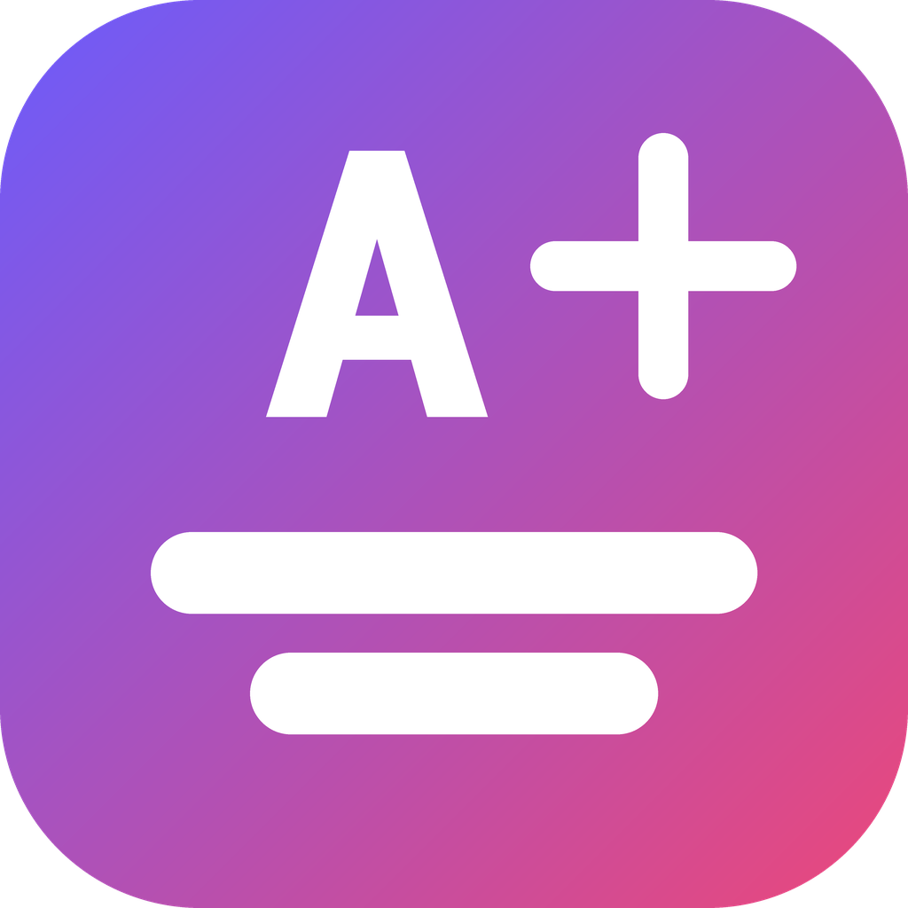

# Altyazı+

**PS5 oyunları için canlı Türkçe çeviri.**
Yapımcı: **Burak Topcu**

Altyazı+, PS5 oyunlarındaki İngilizce yazıları canlı olarak Türkçeye çevirir ve İngilizce yazının tam üstünde, aynı boyda gösterir:

- **Konuşma altyazıları**
- **Oyun içi yazılar:** tuş ipuçları ("Greet", "Press Ⓧ to skip" → "Atlamak için Ⓧ tuşuna basın"), görev ve ipucu yazıları. Tuş simgeleri hiçbir zaman örtülmez.

Türkçe yazı **TV'de** (LG, Samsung, Android TV / Google TV), **PC ekranında** ya da **telefon / tablette** gösterilebilir. PS5 TV'ye bağlı kalır, capture card gerekmez.

## Kurulum

👉 **[KURULUM.md](KURULUM.md)**: adım adım kurulum (PC + TV markasına göre).

Hazır dosyalar **[Releases](../../releases)** sayfasındadır:

| Dosya | Ne için |
|---|---|
| `AltyaziPlus.exe` | Windows programı (zorunlu) |
| `AltyaziPlus-AndroidTV.apk` | Android TV / Google TV uygulaması |
| `tr.ps5altyazi.tv_*.ipk` | LG webOS uygulaması (PC programı kendisi kurar) |
| `AltyaziPlus-Samsung-Tizen.zip` | Samsung TV uygulaması (Tizen Studio ile kurulur) |

## Nasıl çalışır?

1. **Yakalama:** Windows programı oyunu **Sony PS Remote Play** penceresinden yakalar (Windows Graphics Capture).
2. **Okuma:** Altyazıyı ve oyun içi yazıları Windows'un yerleşik OCR'ı ile okur, okuma hatalarını sözlükle düzeltir.
3. **Çeviri:** Yazıyı **DeepL** ile çevirir (kota dolunca yedek servise geçer) ve çeviriyi hafızaya alır.
4. **Gösterim:** Türkçeyi ev ağındaki TV uygulamasına gönderir. TV uygulaması PS5'in HDMI görüntüsünü gösterir ve Türkçeyi üstüne çizer.

| Kısayol | |
|---|---|
| F6 | Çeviriyi başlat / durdur |
| F8 | Türkçeyi göster / gizle |

## Klasörler

| Klasör | İçerik |
|---|---|
| `src/Ps5Altyazi` | Windows programı (C# .NET 8, WPF) |
| `tv/web` | Ortak TV arayüzü (tüm TV markaları) |
| `tv/webos` | LG paketi bilgileri |
| `tv/tizen` | Samsung paketi bilgileri |
| `tv/android` | Android TV uygulaması |

## Notlar

- PS5'e ya da PSN'ye müdahale edilmez, içerik koruması aşılmaz; yalnızca Sony'nin Remote Play uygulaması kullanılır.
- Ekrandan okunan metin yalnızca çeviri servisine gönderilir. API anahtarları bilgisayarda şifreli saklanır.
- İngilizce kelime listesi, [wordfreq](https://github.com/rspeer/wordfreq) verisinden (CC BY-SA 4.0) üretilmiştir.
- Değişiklikler: [CHANGELOG.md](CHANGELOG.md)

© 2026 Burak Topcu

## PS5 bağlantı yardımcısı

PS5'e PS Remote Play uygulaması olmadan bağlanmayı programın içindeki ayrı bir yardımcı program, `ps5-baglanti.exe`
yapar (kaynağı: [tools/ps5-baglanti](tools/ps5-baglanti)). Remote Play protokolünü açık kaynak
[chiaki-ng](https://github.com/chiaki-ng/chiaki-ng) kütüphanesi konuşur; bu yüzden yalnız bu yardımcı program
chiaki-ng'nin lisansıyla (AGPL-3.0) dağıtılır. Altyazı+'ın kendisi onunla yalnız komut satırı üzerinden konuşur.
Ayrıntı: [THIRD-PARTY-NOTICES.md](THIRD-PARTY-NOTICES.md).
